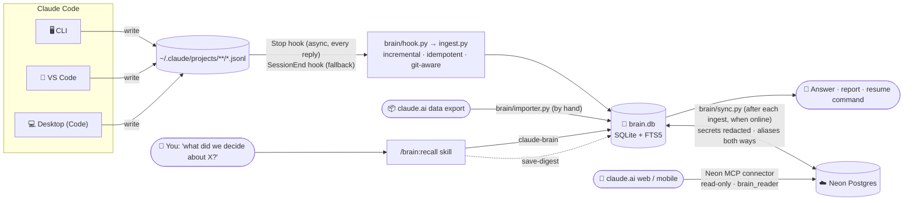
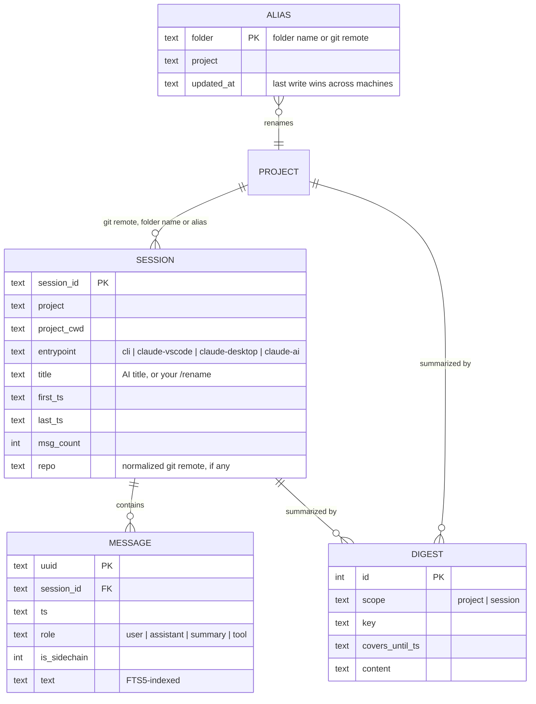

<div align="center">

# 🧠 ClaudeBrain

**Long-term memory for Claude Code.**
Every conversation you have in the terminal or VS Code — archived, searchable and resumable,
in one small SQLite file.


</div>

---

## The problem

Claude Code keeps each session as a JSONL transcript under `~/.claude/projects/` — and then:

- 🗑️ **deletes them after 30 days** (`cleanupPeriodDays` default),
- 🗜️ **compacts** long conversations, so the live context loses the early details,
- 🧩 **scatters** them per folder, per surface (CLI, VS Code, Desktop), with no way to search across them.

Months of decisions, experiments and dead ends simply vanish.

## The idea

> Work with Claude exactly as always. In the background, every message is saved.
> Whenever you need it — *"what did we decide about X?"*, *"resume the session about Y"*,
> *"write me a report of project Z"* — Claude looks it up.

No extra app, no UI to learn: **you ask Claude in plain language, Claude queries the database
and shows you the result.**

---

## ✨ Features

| | |
|---|---|
| ⚡ **Automatic & invisible** | A `Stop` hook archives new messages after every Claude reply, asynchronously (~0.1 s). Nothing to remember. |
| 🖥️ **Every Claude Code surface** | CLI, VS Code extension and Claude Desktop's Code tab all land in the same database, tagged by origin. |
| 📥 **claude.ai chats too** | Import the official data export (web, Desktop and mobile chats); chats in a claude.ai Project join the Claude Code project of the same name. |
| 🔍 **Full-text search** | Accent-insensitive, and each word matches its variants (`regresiones` finds `regresión` and `regression`); `OR`, `"phrases"` and `-exclusions`. Claude widens searches with synonyms and your other languages before giving up. Same results locally and from claude.ai. |
| 📁 **Organized by project** | Git repos are identified by their remote (`github.com/owner/repo`), so every clone and every subfolder lands in one project; other folders by their normalized name — `2026-ML vs GNN` and `MLvsGNN` merge into `mlvsgnn`. Aliases (by folder name or remote) handle the exceptions and are shared by all your computers. |
| 🪟 **Linux, macOS, Windows** | Hooks run Python directly (no shell syntax), paths are handled in both styles. |
| ♻️ **Resumable** | Finds the session and hands you the exact `claude --resume` command — or continues from the archive if the original transcript is gone. |
| 📝 **Lazy digests** | When Claude summarizes a project for you, it caches the summary; the next report only reads what happened since. Zero cost up front. |
| 🪶 **Tiny & dependency-free** | Pure Python stdlib. 1.5 GB of raw transcripts → **18 MB** database, full backfill in **7 s**. |
| ☁️ **Ask from your phone** | Optional mirror to Neon Postgres, queried from claude.ai (web, mobile, Desktop chat) through Neon's official connector — read-only, secrets redacted. |
| 📴 **Offline-first** | The local SQLite is the source of truth; sync just catches up whenever there is internet. |

---

## 🏗️ How it works



**Ingestion** reads each transcript from the last byte offset it saw, so a run with nothing new
costs ~0.1 s. Partial lines (a reply still being written) are left for the next run, and every
message is keyed by its UUID, so concurrent runs and re-runs never duplicate anything.

**Querying** is done by Claude itself through the `claude-brain` skill, which knows the commands
and the workflows (search → read, project → digest → report, find → resume).

### What gets stored

| Role | Content | Shown by default |
|---|---|:---:|
| `user` | Your messages, minus injected noise (`<system-reminder>`, IDE selections…) | ✅ |
| `assistant` | Claude's prose replies, in full | ✅ |
| `summary` | Claude Code's own compaction summaries and "while you were away" recaps — dense gold | ✅ |
| `tool` | Tool calls (input truncated to 300 chars) and results (truncated to 200 chars) | `--tools` |

Dropped entirely: thinking blocks, meta messages, task notifications, API bookkeeping, images.
Imported claude.ai chats use the same roles (their conversation `summary`, when present, as `summary`).
Subagent messages are kept but flagged (`--sidechain` to include them).

### Data model



---

## 🚀 Installation

> Requirements: Claude Code, and `python3` 3.10+ with SQLite FTS5 (any python.org / distro
> build). For the optional cloud mirror also [uv](https://docs.astral.sh/uv/).

### As a Claude Code plugin (recommended)

```text
/plugin install brain --marketplace aavzpy2023/ClaudeBrain
```

<sub>On Claude Code older than 2.1.275: `/plugin marketplace add aavzpy2023/ClaudeBrain`, then
`/plugin install brain@aavzpy2023`.</sub>

That's it — **everything runs locally**:

- Archiving starts with Claude's next reply, in every project. The first run backfills the
  history Claude Code still has on disk (all projects at once), so nothing waits for you to open
  a project.
- Ask about past work and the `/brain:recall` skill answers; the `claude-brain` command is on
  Claude's PATH while the plugin is enabled.
- The database lives in `~/.local/share/claude-brain/brain.db`, outside the plugin, so updates
  and uninstalls never touch it.

Then, optionally:

| Command | What it does |
|---|---|
| `/brain:setup` | Shows what's archived and offers the two recommended settings: `cleanupPeriodDays` 3650 (Claude Code otherwise deletes transcripts after 30 days) and a permanent permission for `claude-brain`, so recall never prompts. A plugin can't change your settings by itself, so it asks |
| `/brain:cloud` | Walks you through the cloud mirror below, step by step |

<details>
<summary><b>Manual install</b> — Windows, or without plugins</summary>

The plugin's hooks call `python3`, which most Windows installs don't have. The manual installer
writes hooks with the exact interpreter that runs it, so use it there (or if you don't use
plugins). **Use one or the other, not both** — both would run the hooks.

```bash
git clone git@github.com:aavzpy2023/ClaudeBrain.git ~/Projects/ClaudeBrain
python3 ~/Projects/ClaudeBrain/brain/install.py          # Windows: py -3 brain\install.py
```

| Step | What it does |
|---|---|
| Skill | Renders the skill with this machine's paths into `~/.claude/skills/claude-brain/` |
| Hooks | Async `Stop` hook (ingest, then sync if Neon is configured) and `SessionEnd` hook (ingest), exec form, no shell |
| Permission | Allows the skill's exact command, so queries never prompt |
| Retention | Raises `cleanupPeriodDays` to 3650 |
| Backfill | Archives everything Claude Code still has on disk |
| Cloud | With `NEON_URL` already set: creates the remote schema and uploads |

It merges into `~/.claude/settings.json` without touching your other settings, replaces its
own previous hooks instead of duplicating them, and leaves a backup in
`settings.json.bak-claudebrain`. Honors `CLAUDE_CONFIG_DIR`. Open `/hooks` once (or restart
Claude Code) afterwards. `python3 brain/install.py --uninstall` removes its hooks, permission
and skill — e.g. before switching to the plugin — and keeps your database.

On Windows the files live under your user folder: `%USERPROFILE%\.claude\` for Claude Code,
`%USERPROFILE%\.local\share\claude-brain\brain.db` for the database. Claude's own queries go
through its Bash tool (Git Bash), hence the forward-slash paths in the skill. Windows support is
not yet tested on a real machine.

</details>

### ☁️ Cloud mirror + claude.ai access (optional)

Turn it on whenever you like; until then nothing leaves your machine. Easiest: run
`/brain:cloud`. By hand:

1. Create a free [Neon](https://neon.tech) project. Put its **owner** connection string and its
   project id in `~/.config/claude-brain/.env`, then `chmod 600` it. Never commit it, never paste
   it into a chat — conversations get archived.
   ```bash
   NEON_URL=postgresql://…            # Neon → Connect
   NEON_PROJECT_ID=…                  # Neon → Settings → General
   ```
2. `claude-brain cloud init` — tables, search functions and the read-only role `brain_reader`;
   uploads everything archived so far. From now on the hook pushes after every reply.
3. `claude-brain cloud reader-password` — the connector logs in as `brain_reader`.
4. `claude-brain cloud instructions` — prints the connector URL and the claude.ai "Brain"
   project instructions, filled in with your project id
   (template: [`remote/claude_ai_instructions.md`](remote/claude_ai_instructions.md)).

What reaches the cloud is redacted first: API keys, GitHub/AWS/Google/Slack tokens, JWTs,
private keys, passwords in URLs and `password=`/`token:`-style assignments become
`[REDACTED:…]`. The connector runs as `brain_reader`, a role created with SQL that can only
`SELECT` (Console-created Neon roles join `neon_superuser` and could read everything), inside
read-only transactions (`readonly=true`) and with only Neon's SQL tools exposed
(`category=querying`).

### 🔄 Who updates what

**Only your computers write; claude.ai only reads.**

```
every Claude reply (Stop hook → hook.py, background)
   ├─ ingest.py → local brain.db          always, offline too
   └─ sync.py   ⇄ Neon                    new rows up, aliases both ways; only when online
closing a session (SessionEnd hook → hook.py)
   └─ ingest.py → local brain.db          (its last messages reach Neon with the next reply)
you, from time to time
   └─ importer.py → local brain.db        claude.ai chats; reach Neon with the next sync
```

- `sync.py` connects with the owner string in `~/.config/claude-brain/.env` — the only
  credential that can write, and it never leaves the machine.
- Offline? Archiving keeps working locally; the next reply with internet uploads the backlog.
- Computer off? Neon stays as of the last synced reply; claude.ai keeps answering from that.
- Chats in claude.ai / the mobile app are **not** written automatically (no hooks there) —
  bring them in from time to time with the importer (see Usage).
- Force a sync by hand: `claude-brain sync`; see where things stand: `claude-brain status`.

### 💻 Several computers

Install the plugin on each machine and give every `.env` the **same** Neon database.
Each computer keeps its own local `brain.db` (its own sessions) and pushes into the shared
mirror, so claude.ai sees the union of all of them.

- No collisions: messages and sessions use Claude Code's global UUIDs; digests are keyed by
  `<hostname>:<local id>`.
- On a new machine, the first reply after installing backfills that machine's existing
  transcripts (whatever Claude Code hasn't deleted yet) and uploads them.
- **The same project adds up across machines.** A session's project is decided, most specific
  first, by: an alias on its git remote → an alias on any folder of its cwd (deepest first) →
  the repo's name (from the remote, else the repo root folder) → the cwd's last folder. The
  remote is read from `.git/config` (worktrees and submodules included, no `git` binary needed)
  the first time a session is seen and then kept, even if the folder is deleted later. So a
  clone named differently, or a session opened in `repo/src/deep`, still lands in the repo's
  project. Aliases are keyed by folder name or remote (`leai-cli` → `devleaicli` wherever it
  lives). Aliases sync both ways through Neon (last write wins), so one created at home
  relabels the work PC's sessions on its next sync — and vice versa.
- A *session* belongs to one machine (Claude Code gives each conversation its own id); it's the
  *project* that collects sessions from every computer.
- Locally, each machine only searches its own sessions; the union lives in Neon (claude.ai).
- On a machine you don't fully trust (e.g. a work laptop), consider a dedicated Neon role with
  only `INSERT/UPDATE/SELECT` on the three tables instead of the owner string.

---

## 💬 Usage

### Just ask Claude

The skill triggers on requests about past work, in any language — your archive keeps whatever
language you worked in, and Claude reads and answers in yours:

```text
> what did we decide about the paper downloader architecture?
> search my history for how I set up the SSH tunnel
> pick up the session about the papers.sqlite charts
> write a report on everything in the meta-analysis project
> which sessions do I have for the thesis?
```

Behind the scenes Claude runs the CLI below, reads the results and answers, writes the
document you asked for, or gives you the exact command to resume.

### Or use the CLI directly

`claude-brain` is on Claude's PATH with the plugin; in your own terminal call
`<plugin or clone folder>/bin/claude-brain`, or put that folder on your PATH.

```bash
Q=claude-brain

$Q status                                     # what's archived, pending sync, retention, cloud
$Q projects                                   # all projects, sessions, last activity
$Q recent --project thesis --limit 5          # latest sessions (partial names work)
$Q search "graphsage naive bayes" --since 2026-10-01
$Q search 'rendimiento OR performance OR slow -benchmark'   # alternatives, exclusion
$Q search '"paper downloader"'               # exact phrase
$Q session f1c3077a --max-chars 8000          # condensed transcript (id prefix works)
$Q session f1c3077a --after 2026-10-19T12:12:45Z   # next page
$Q project mlvsgnn                            # timeline + latest digest
$Q save-digest project mlvsgnn <<'EOF'        # cache a distilled summary
Goal… decisions… results… open issues…
EOF
$Q alias "Course assignments" coursework   # folder name → project, any depth, all machines
$Q alias git@github.com:me/leai-cli.git devleaicli   # git remote, any URL form
$Q alias ~/Projects/leai-cli devleaicli       # existing path: its folder name + its repo's remote
```

```text
$ claude-brain project phdthesis
# project phdthesis

(no digest yet)

## sessions (* = not covered by the digest)
* 1df0b0ad  2026-10-15 20:10 → 2026-10-19 12:10  claude-vscode  788 msgs  Paper downloader for ScienceDirect
* 81b0deaa  2026-10-16 11:52 → 2026-10-16 20:23  claude-vscode  654 msgs  Migrate PaperDownloader from Flask to FastAPI
* 44705308  2026-10-17 13:56 → 2026-10-17 17:43  cli            78 msgs  Remote folders over SSH in VS Code
…
```

### Importing your claude.ai chats

Chats in claude.ai (web, Desktop app, mobile) have no hooks, so they come in through the official
export: **Settings → Privacy → Export data**. You get a `manifest-….json` with one link per file
(each link expires in 24 h and may work only once — open each in the browser where you're
logged in, let it finish):

| File | Contains | Imported |
|---|---|:---:|
| `conversations-000.zip` | `conversations.json` — every chat | ✅ |
| `projects-000.zip` | `projects/<uuid>.json` — one per claude.ai Project | names only |
| `frames-000.zip` | artifacts (HTML versions, pages) | — |
| `light_metadata-000.zip` | user and **login history** | never read |

Put the zips (extracted or not) in one folder and point the importer at it, or at any one of them:

```bash
claude-brain import ~/Downloads --inspect   # look first: counts, fields, block types
claude-brain import ~/Downloads             # import; only the export's zips are opened
```

- Each chat becomes a session with origin `claude-ai` (`--source claude-ai` in searches).
- A chat inside a claude.ai Project goes to the project of that name, so the claude.ai Project
  "PhD Thesis" and the Claude Code folder `PhD Thesis` add up in `phdthesis`; aliases apply.
  **Currently the export doesn't say which Project a chat belongs to** (checked on a real
  export, Oct 2026), so for now every chat goes to `claudeai`; the code picks the link up as
  soon as the export includes it.
- Messages keep their text, tool calls (truncated like Claude Code's), attachment names plus the
  start of their extracted text, document titles and file names. Dropped: thinking, images'
  bytes, and claude.ai's injected instructions (`injected_prompt_block`). Messages that are
  empty in the export itself (interrupted replies, edit branches) are skipped.
- Re-import a newer export whenever you like: only new messages are added. The next sync (the
  next Claude Code reply, or `sync.py`) uploads them to Neon.
- The export format is undocumented and may change; `--inspect` shows what yours contains.
- After importing you can delete the downloaded files — especially `light_metadata` (login
  history) and the manifest (download links).

### Resuming an old conversation

| Situation | What happens |
|---|---|
| Original `.jsonl` still on disk | Full-fidelity native resume: `cd "<project folder>" && claude --resume <session-id>` (in VS Code: open the folder, pick it from session history). |
| Transcript already deleted | Claude continues **from the archive**: reads the condensed session plus its compaction summaries, restates where things stood, and carries on. |

---

## ⚙️ Configuration

| Variable / file | Default | Purpose |
|---|---|---|
| `CLAUDE_BRAIN_DB` | `~/.local/share/claude-brain/brain.db` | Database location |
| `CLAUDE_CONFIG_DIR` | `~/.claude` | Claude Code's folder: transcripts, settings, skills |
| `NEON_URL` (env or `~/.config/claude-brain/.env`) | — | Owner connection string; enables the cloud mirror |
| `ingest.py --root` | `~/.claude/projects` | Where transcripts are read from |
| `claude-brain ingest --full` | off | Re-read every file from the start (safe: deduplicated) |
| `~/.local/share/claude-brain/ingest.log` | — | Hook errors end up here |

**Backups:** the database is a single file. Snapshot it safely, even while it is in use:

```bash
sqlite3 ~/.local/share/claude-brain/brain.db ".backup '/path/to/backup/brain.db'"
```

Don't put the *live* database in a synced folder (Dropbox, Drive…) — sync can corrupt a SQLite
file mid-write. Back it up there instead.

---

## 🧪 Development

```bash
uv run pytest                      # 65 tests, in-memory fixtures, < 1 s
claude plugin validate .           # plugin + marketplace manifests
claude --plugin-dir .              # try the plugin from a checkout, without installing it
```

```
.claude-plugin/
  plugin.json        plugin manifest (name "brain", shown as ClaudeBrain)
  marketplace.json   this repo is its own marketplace
hooks/hooks.json     Stop (async: ingest + sync) and SessionEnd (ingest) → brain/hook.py
skills/recall/       the recall skill (/brain:recall); install.py renders it for manual installs
commands/            /brain:setup and /brain:cloud
bin/claude-brain     CLI on Claude's PATH while the plugin is enabled
brain/
  cli.py       claude-brain subcommands
  db.py        schema, connection, project naming rules
  ingest.py    incremental JSONL → SQLite archiver
  hook.py      what the hooks run: ingest, then sync; logs errors, never fails
  gitrepo.py   repo root + normalized remote of a folder, straight from .git files
  importer.py  claude.ai data export → sessions with origin claude-ai
  query.py     search / sessions / projects / digests — library + CLI
  sync.py      push to Neon (watermarks, redaction, offline-safe) — psycopg via uv
  install.py   manual installer (Windows / no plugins), --uninstall
remote/
  schema.sql   Postgres mirror, brain_* query functions, read-only role
  claude_ai_instructions.md   template for the claude.ai connector + project
tests/         synthetic transcripts, temp databases
context.md     index for Claude: where each rule lives
```

The query layer is plain functions over a `sqlite3.Connection`, so an MCP server could reuse it
as is.

---

## ❓ FAQ

<details>
<summary><b>Do I have to open each project for it to be archived / synced?</b></summary>

No. The hooks live in your **user** settings (`~/.claude/settings.json`), so they run in every
project you open, and each run scans **all** of `~/.claude/projects/`, not just the current
project: whichever session triggers it, new messages from every project are archived and
pushed. Only what changed since the last run is read (~0.1 s). The first run's backfill is
global too.

Example — a computer with 5 projects:

- The first Claude reply after installing (in any project) archives — and, with the cloud on,
  uploads — the existing sessions of **all 5**. With the manual installer it happens during the
  install itself.
- Afterwards you work in project A while a session of project B is still running in another
  window: B's new messages go up with the next Claude reply, whether that reply is in A or in B.
  No project waits for you to open it.

</details>

<details>
<summary><b>What happens when I install it on another computer?</b></summary>

Install the plugin there and put the same `NEON_URL` (and `NEON_PROJECT_ID`) in its `.env`.
With the first Claude reply, the hook:

1. archives every Claude Code session that computer still has, all projects, into its own
   local `brain.db`, and detects each session's git repo (the project folders must exist there;
   missing ones fall back to the folder name — re-check later with `claude-brain ingest --full`);
2. downloads the aliases from Neon and relabels those sessions with them (`leai` or
   `leai-cli/src` → `devleaicli`);
3. uploads messages and sessions to Neon, already under the right project names;

and from then on every reply there is archived and pushed. Run `claude-brain status` to watch
it; `claude-brain sync` forces a push.

In claude.ai, sessions from both computers then appear together under the same project. Keep in
mind:

- Only what that computer still has can be recovered: until `cleanupPeriodDays` is raised
  (`/brain:setup`), Claude Code there was deleting sessions older than 30 days.
- Forgot the `.env`? Everything works locally; add it later and the next reply uploads it all.
- Each machine's local `brain.db` holds only its own sessions — the union lives in Neon, so
  query claude.ai to see both. Local Claude Code searches see that machine only.
- The first sync takes seconds to a couple of minutes depending on volume; later ones only send
  what's new.

</details>

<details>
<summary><b>Does a session merge with "the same session" on another computer?</b></summary>

There is no such thing: Claude Code gives every conversation its own id on the machine where it
happens. What merges is the **project** — sessions from all computers that belong to the same
repo (same remote) or the same aliased folder end up under one project name.

</details>

## 🗺️ Roadmap

- [x] Incremental, idempotent archiver for all Claude Code surfaces
- [x] Full-text search, projects, sessions, lazy digests, aliases
- [x] Real-time archiving (async `Stop` hook)
- [x] Resume workflow (native `--resume` or from the archive)
- [x] **claude.ai access** — Neon mirror + official Neon MCP connector, read-only
- [ ] Save digests from claude.ai (write grant on `digests` only, pulled back to local)
- [x] **claude.ai importer** — the official data export (`conversations.json`) for non-Code chats
- [x] Importer validated against a real export (Oct 2026: 51 chats, 924 messages)
- [ ] Assign imported claude.ai chats to projects (the export has no chat→project link)
- [x] Word variants (light stemming + prefix), `OR` / phrases / exclusions, identical locally and in Neon
- [ ] CJK-aware search (FTS5 `trigram` tokenizer / Postgres `pg_trgm`) for Chinese, Japanese, Korean
- [ ] Optional semantic search — design notes:
  - Local only for free-text queries: `fastembed` (ONNX, CPU) with a **multilingual** model
    (the default `bge-small-en` is English-only), run via `uv --with fastembed` so the core
    stays dependency-free; embed in batches (not in the per-reply hook), chunk long messages,
    skip tool output, merge with keyword hits (e.g. reciprocal rank fusion).
  - Neon: pgvector stores the vectors but can't embed a new query (Neon's in-database
    `pgrag` is deprecated and English-only), so claude.ai gets **"more like this"** instead:
    `brain_similar(message_id)` ranks by the stored vector of a message found by keyword
    search — cross-language with a multilingual model.
  - ~35 MB of vectors for ~23k messages at 384 dimensions. Build it only if keyword search
    plus Claude's query expansion proves insufficient in practice.
- [ ] Topics inside a project (`phdthesis → paperdownloader / writing / tooling`), assigned while summarizing
- [x] Installer (paths, skill, settings merge, backfill, first sync)
- [x] Claude Code plugin + marketplace (local by default, cloud opt-in)
- [ ] Plugin icon and a short demo GIF
- [x] Several computers feeding one cloud mirror
- [x] Share aliases across machines through Neon
- [x] Windows support (exec-form hooks, both path styles) — awaiting a real-machine test
- [x] Git-aware projects: same remote = same project, on any machine and in any subfolder

## 📜 Changelog

### 0.8.0
- Better search, the same locally and in Neon: each word matches its variants (light
  Spanish/English-style stemming + prefix), `a OR b`, `"exact phrase"`, `-exclude`; any input is
  safe. Neon now splits paths, URLs and hyphenated words like the local index, so both return
  identical results.
- The skill and the claude.ai instructions tell Claude to widen searches with synonyms and the
  user's other languages before concluding something isn't there.
- Sync always connects to Neon's direct endpoint: through the pooled one, session state such as
  `SET ROLE` can leak between clients.

### 0.7.0
- **Claude Code plugin**: `/plugin install brain --marketplace aavzpy2023/ClaudeBrain` installs
  everything local — hooks, the `/brain:recall` skill, the `claude-brain` command. Cloud stays
  optional: `/brain:setup` and `/brain:cloud` guide the rest.
- `claude-brain` CLI: recall, `ingest`, `import`, `status`, `cloud init | reader-password |
  instructions | sync`.
- No personal data in the repo: claude.ai instructions are a template filled from
  `NEON_PROJECT_ID`.
- Sync runs through `uv --with psycopg` (no venv inside the plugin folder); the hook finds uv
  itself and stays local-only until `NEON_URL` exists.
- `install.py` kept for Windows / no plugins, now with `--uninstall`.

### 0.6.2
- Docs, skill triggers and claude.ai instructions in English; the skill now says it works in any
  language.
- Project names keep letters of any script (`项目`, `проект`) instead of dropping non-ASCII
  letters; accents are still stripped (`Tésis` → `tesis`, `Straße` → `strasse`).
- Documented the CJK search limitation.

### 0.6.1
- Importer adapted to the real 2026 export: a manifest of per-category zips, projects as one file
  each; reads only `conversations*`/`projects*` zips from a folder, deduplicates zip + extracted
  copies, keeps document titles and the conversation `summary`, drops injected prompt blocks.

### 0.6.0
- `brain/importer.py`: imports the claude.ai data export (zip, folder or `conversations.json`),
  idempotently; `--inspect` describes an export without importing. Chats in a claude.ai Project
  join the project of that name; others go to `claudeai`. New origin `claude-ai`.

### 0.5.0
- Projects follow git: sessions store their repo (`sessions.repo`, normalized remote) and the
  repo's name becomes the default project, so subfolders and differently named clones merge.
- Aliases can target a git remote (any URL form); aliasing an existing repo path covers both its
  folder name and its remote. Remote credentials are never stored.
- `ingest.py --full` re-checks folders that previously looked like non-repos.

### 0.4.0
- Aliases are keyed by **folder name** instead of absolute path (deepest matching folder wins),
  so they hold on every machine; old path aliases migrate automatically.
- Aliases sync both ways through Neon (`aliases` table, last write wins) and relabel sessions.
- Windows support: hooks call `brain/hook.py` in exec form (no shell), POSIX and Windows paths
  both understood, forward-slash paths in the skill and permission rule.

### 0.3.0
- `brain/install.py`: one-command, idempotent installer (skill rendered with local paths,
  hooks + permission merged into settings.json with backup, backfill, first sync).
- Several computers can share one Neon mirror; remote digests keyed by `<hostname>:<id>`
  (schema auto-upgrades with `sync.py --init`).
- `CLAUDE_CONFIG_DIR` honored for transcripts and settings.
- README: who updates Neon, multi-computer setup.

### 0.2.1
- `brain_reader` needs a password: the Neon connector logs in as that role (documented in `remote/`).
- claude.ai connector URL now adds `category=querying`: 5 SQL tools instead of ~46 Neon
  management tools, so "my projects" is answered from the archive, not with Neon projects.

### 0.2.0
- Neon Postgres mirror: incremental push (`brain/sync.py`), offline-safe, secret redaction.
- `remote/schema.sql`: accent-insensitive FTS, `brain_*` SQL functions, read-only `brain_reader` role.
- claude.ai connector + project instructions to query the brain from web and mobile.

### 0.1.0
- First release: archiver, query CLI, `claude-brain` skill, `Stop` + `SessionEnd` hooks.
- Projects from normalized folder names (leading year dropped), aliases for exceptions.
- Custom `/rename` titles take precedence over AI-generated ones.
- Compaction summaries and away-recaps stored as first-class `summary` messages.

---

## ⚠️ Limitations

- Only what Claude Code still had on disk when ClaudeBrain was installed can be backfilled;
  transcripts already removed by the 30-day cleanup are gone.
- Claude Desktop / claude.ai **chat** conversations (non-Code) only arrive when you import an
  export; there is no automatic capture for them.
- Tool outputs are truncated by design; the archive preserves the conversation, not every
  byte of every command output.
- Transcripts may contain secrets you pasted into a session. The local database keeps them
  as is; the cloud mirror gets a redacted copy, but redaction is pattern-based — an unusual
  secret format can slip through.
- From claude.ai the brain is read-only for now: summaries can only be saved from Claude Code.
- **No semantic search.** Search matches words and their variants, not meaning: "speed
  problems" won't find "it's very slow" unless Claude expands the query (it's told to, with
  synonyms and your other languages). Embeddings would need a model and wouldn't work from
  claude.ai, so they're left as an optional idea.
- **Chinese, Japanese and Korean search is weak.** Both SQLite FTS5 (`unicode61`) and Postgres
  (`simple`) split words on spaces and punctuation; CJK text has none, so a whole sentence
  becomes one token and a word inside it isn't found (a word at the start of a sentence still
  matches as a prefix). Archiving, project names and reading sessions work in any script — see
  the roadmap for search.

## License

[MIT](LICENSE) © 2026 Andrey
