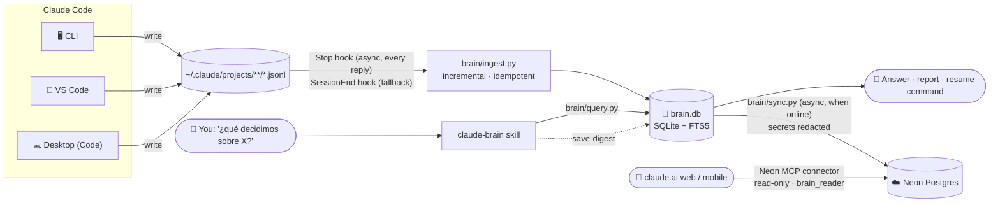
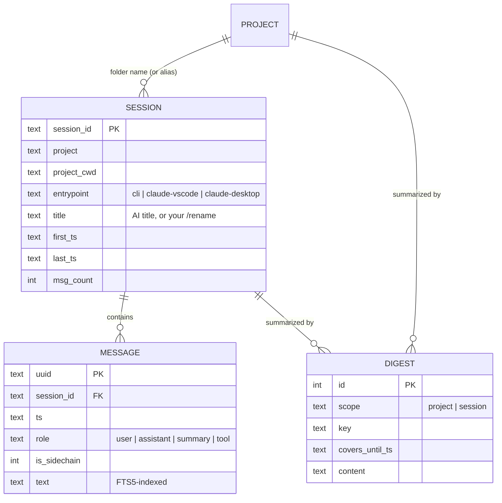

<div align="center">

# 🧠 ClaudeBrain

**Long-term memory for Claude Code.**
Every conversation you have in the terminal or VS Code — archived, searchable and resumable,
in one small SQLite file.


</div>

---

## The problem

Claude Code keeps each session as a JSONL transcript under `~/.claude/projects/` — and then:

- 🗑️ **deletes them after 30 days** (`cleanupPeriodDays` default),
- 🗜️ **compacts** long conversations, so the live context loses the early details,
- 🧩 **scatters** them per folder, per surface (CLI, VS Code, Desktop), with no way to search across them.

Months of decisions, experiments and dead ends simply vanish.

## The idea

> Work with Claude exactly as always. In the background, every message is saved.
> Whenever you need it — *"what did we decide about X?"*, *"resume the session about Y"*,
> *"write me a report of project Z"* — Claude looks it up.

No extra app, no UI to learn: **you ask Claude in plain language, Claude queries the database
and shows you the result.**

---

## ✨ Features

| | |
|---|---|
| ⚡ **Automatic & invisible** | A `Stop` hook archives new messages after every Claude reply, asynchronously (~0.1 s). Nothing to remember. |
| 🖥️ **Every Claude Code surface** | CLI, VS Code extension and Claude Desktop's Code tab all land in the same database, tagged by origin. |
| 🔍 **Full-text search** | SQLite FTS5, accent-insensitive (`regresion` finds `regresión`), ranked with BM25, with highlighted snippets. |
| 📁 **Organized by project** | A project is its folder name, normalized — `2026-ML vs GNN` and `MLvsGNN` merge into `mlvsgnn` automatically. Aliases handle the exceptions. |
| ♻️ **Resumable** | Finds the session and hands you the exact `claude --resume` command — or continues from the archive if the original transcript is gone. |
| 📝 **Lazy digests** | When Claude summarizes a project for you, it caches the summary; the next report only reads what happened since. Zero cost up front. |
| 🪶 **Tiny & dependency-free** | Pure Python stdlib. 1.5 GB of raw transcripts → **18 MB** database, full backfill in **7 s**. |
| ☁️ **Ask from your phone** | Optional mirror to Neon Postgres, queried from claude.ai (web, mobile, Desktop chat) through Neon's official connector — read-only, secrets redacted. |
| 📴 **Offline-first** | The local SQLite is the source of truth; sync just catches up whenever there is internet. |

---

## 🏗️ How it works



**Ingestion** reads each transcript from the last byte offset it saw, so a run with nothing new
costs ~0.1 s. Partial lines (a reply still being written) are left for the next run, and every
message is keyed by its UUID, so concurrent runs and re-runs never duplicate anything.

**Querying** is done by Claude itself through the `claude-brain` skill, which knows the commands
and the workflows (search → read, project → digest → report, find → resume).

### What gets stored

| Role | Content | Shown by default |
|---|---|:---:|
| `user` | Your messages, minus injected noise (`<system-reminder>`, IDE selections…) | ✅ |
| `assistant` | Claude's prose replies, in full | ✅ |
| `summary` | Claude Code's own compaction summaries and "while you were away" recaps — dense gold | ✅ |
| `tool` | Tool calls (input truncated to 300 chars) and results (truncated to 200 chars) | `--tools` |

Dropped entirely: thinking blocks, meta messages, task notifications, API bookkeeping, images.
Subagent messages are kept but flagged (`--sidechain` to include them).

### Data model



---

## 🚀 Installation

> Requirements: Linux/macOS, Python 3.10+ with SQLite FTS5 (any modern build), Claude Code.

**1. Clone**

```bash
git clone git@github.com:aavzpy2023/ClaudeBrain.git ~/Projects/ClaudeBrain
export BRAIN=~/Projects/ClaudeBrain   # used in the steps below
```

**2. Backfill everything Claude Code still has on disk**

```bash
/usr/bin/python3 $BRAIN/brain/ingest.py --full
# ingested 116 file(s), 115 session(s) in 7.2s
```

**3. Install the skill** (user-level, so it works in every project)

```bash
ln -sfn $BRAIN/skill ~/.claude/skills/claude-brain
```

> ⚠️ `skill/SKILL.md` contains the absolute path to `query.py`. If you cloned somewhere else,
> update that path (and the permission rule below) to match.

**4. Add to `~/.claude/settings.json`** (merge with what you already have)

```jsonc
{
  "cleanupPeriodDays": 3650,          // stop Claude Code from deleting transcripts after 30 days
  "permissions": {
    "allow": [
      // lets the skill query without asking every time
      "Bash(/usr/bin/python3 /ABS/PATH/ClaudeBrain/brain/query.py:*)"
    ]
  },
  "hooks": {
    "Stop": [{                         // archive after every reply, in the background
      "hooks": [{
        "type": "command",
        "command": "/usr/bin/python3 /ABS/PATH/ClaudeBrain/brain/ingest.py --quiet 2>>\"$HOME/.local/share/claude-brain/ingest.log\" || true",
        "timeout": 120,
        "async": true
      }]
    }],
    "SessionEnd": [{                   // fallback when a session closes
      "hooks": [{
        "type": "command",
        "command": "/usr/bin/python3 /ABS/PATH/ClaudeBrain/brain/ingest.py --quiet 2>>\"$HOME/.local/share/claude-brain/ingest.log\" || true",
        "timeout": 120
      }]
    }]
  }
}
```

Open `/hooks` once (or restart Claude Code) so running sessions pick up the change. Done.

---

**5. (Optional) Cloud mirror + claude.ai access**

Create a Neon project, put its connection string in `~/.config/claude-brain/.env`
(`NEON_URL=postgresql://…`, `chmod 600`, never commit it), then:

```bash
uv run $BRAIN/brain/sync.py --init     # creates tables, search functions and the read-only role
```

Chain the sync after the ingest in the `Stop` hook:

```bash
… ingest.py --quiet 2>>"$LOG"; /path/to/uv run --quiet --project $BRAIN $BRAIN/brain/sync.py --quiet 2>>"$LOG" || true
```

Finally add the connector and the "Brain" project on claude.ai following
[`remote/claude_ai_instructions.md`](remote/claude_ai_instructions.md).

What reaches the cloud is redacted first: API keys, GitHub/AWS/Google/Slack tokens, JWTs,
private keys, passwords in URLs and `password=`/`token:`-style assignments become
`[REDACTED:…]`. The connector runs as `brain_reader`, a role created with SQL that can only
`SELECT` (Console-created Neon roles join `neon_superuser` and could read everything).

---

## 💬 Usage

### Just ask Claude

The skill triggers on requests about past work, in English or Spanish:

```text
> ¿qué decidimos sobre la arquitectura del paper downloader?
> busca en mi historial cómo configuré el túnel SSH
> retoma la sesión de las gráficas de papers.sqlite
> hazme un informe de todo el proyecto meta-análisis
> ¿qué sesiones tengo de la tesis?
```

Behind the scenes Claude runs the CLI below, reads the results and answers, writes the
document you asked for, or gives you the exact command to resume.

### Or use the CLI directly

```bash
Q="/usr/bin/python3 $BRAIN/brain/query.py"

$Q projects                                   # all projects, sessions, last activity
$Q recent --project thesis --limit 5          # latest sessions (partial names work)
$Q search "graphsage regresión" --since 2026-10-01
$Q session f1c3077a --max-chars 8000          # condensed transcript (id prefix works)
$Q session f1c3077a --after 2026-10-19T12:12:45Z   # next page
$Q project mlvsgnn                            # timeline + latest digest
$Q save-digest project mlvsgnn <<'EOF'        # cache a distilled summary
Goal… decisions… results… open issues…
EOF
$Q alias "~/Dropbox/PhD/Tarea 1" estadistica-tarea1   # group/rename folders
```

```text
$ query.py project phdthesis
# project phdthesis

(no digest yet)

## sessions (* = not covered by the digest)
* 1df0b0ad  2026-10-15 20:10 → 2026-10-19 12:10  claude-vscode  788 msgs  Paper_downloader para ScienceDirect
* 81b0deaa  2026-10-16 11:52 → 2026-10-16 20:23  claude-vscode  654 msgs  Migración PaperDownloader de Flask a FastAPI
* 44705308  2026-10-17 13:56 → 2026-10-17 17:43  cli            78 msgs  Carpetas remotas por SSH en VS Code
…
```

### Resuming an old conversation

| Situation | What happens |
|---|---|
| Original `.jsonl` still on disk | Full-fidelity native resume: `cd "<project folder>" && claude --resume <session-id>` (in VS Code: open the folder, pick it from session history). |
| Transcript already deleted | Claude continues **from the archive**: reads the condensed session plus its compaction summaries, restates where things stood, and carries on. |

---

## ⚙️ Configuration

| Variable / file | Default | Purpose |
|---|---|---|
| `CLAUDE_BRAIN_DB` | `~/.local/share/claude-brain/brain.db` | Database location |
| `ingest.py --root` | `~/.claude/projects` | Where transcripts are read from |
| `ingest.py --full` | off | Re-read every file from the start (safe: deduplicated) |
| `~/.local/share/claude-brain/ingest.log` | — | Hook errors end up here |

**Backups:** the database is a single file. Snapshot it safely, even while it is in use:

```bash
sqlite3 ~/.local/share/claude-brain/brain.db ".backup '/path/to/backup/brain.db'"
```

Don't put the *live* database in a synced folder (Dropbox, Drive…) — sync can corrupt a SQLite
file mid-write. Back it up there instead.

---

## 🧪 Development

```bash
uv run pytest            # 24 tests, in-memory fixtures, < 1 s
```

```
brain/
  db.py        schema, connection, project naming rules
  ingest.py    incremental JSONL → SQLite archiver (the hook)
  query.py     search / sessions / projects / digests — library + CLI
  sync.py      push to Neon (watermarks, redaction, offline-safe) — needs psycopg
remote/
  schema.sql   Postgres mirror, brain_* query functions, read-only role
  claude_ai_instructions.md   connector URL + claude.ai project instructions
skill/
  SKILL.md     the claude-brain skill (symlinked into ~/.claude/skills)
tests/         synthetic transcripts, temp databases
context.md     index for Claude: where each rule lives
```

The query layer is plain functions over a `sqlite3.Connection`, so the planned MCP server can
reuse it as is.

---

## 🗺️ Roadmap

- [x] Incremental, idempotent archiver for all Claude Code surfaces
- [x] Full-text search, projects, sessions, lazy digests, aliases
- [x] Real-time archiving (async `Stop` hook)
- [x] Resume workflow (native `--resume` or from the archive)
- [x] **claude.ai access** — Neon mirror + official Neon MCP connector, read-only
- [ ] Save digests from claude.ai (write grant on `digests` only, pulled back to local)
- [ ] **claude.ai importer** — ingest the official data export (`conversations.json`) for non-Code chats
- [ ] Topics inside a project (`phdthesis → paperdownloader / writing / tooling`), assigned while summarizing
- [ ] Install script (paths, skill symlink, settings merge) instead of manual steps

## 📜 Changelog

### 0.2.0 — 2026-10-23
- Neon Postgres mirror: incremental push (`brain/sync.py`), offline-safe, secret redaction.
- `remote/schema.sql`: accent-insensitive FTS, `brain_*` SQL functions, read-only `brain_reader` role.
- claude.ai connector + project instructions to query the brain from web and mobile.

### 0.1.0 — 2026-10-23
- First release: archiver, query CLI, `claude-brain` skill, `Stop` + `SessionEnd` hooks.
- Projects from normalized folder names (leading year dropped), aliases for exceptions.
- Custom `/rename` titles take precedence over AI-generated ones.
- Compaction summaries and away-recaps stored as first-class `summary` messages.

---

## ⚠️ Limitations

- Only what Claude Code still had on disk when ClaudeBrain was installed can be backfilled;
  transcripts already removed by the 30-day cleanup are gone.
- Claude Desktop / claude.ai **chat** conversations (non-Code) live on Anthropic's servers and
  are not archived yet — see the roadmap.
- Tool outputs are truncated by design; the archive preserves the conversation, not every
  byte of every command output.
- Transcripts may contain secrets you pasted into a session. The local database keeps them
  as is; the cloud mirror gets a redacted copy, but redaction is pattern-based — an unusual
  secret format can slip through.
- From claude.ai the brain is read-only for now: summaries can only be saved from Claude Code.

## License

[MIT](LICENSE) © 2026 Andrey
